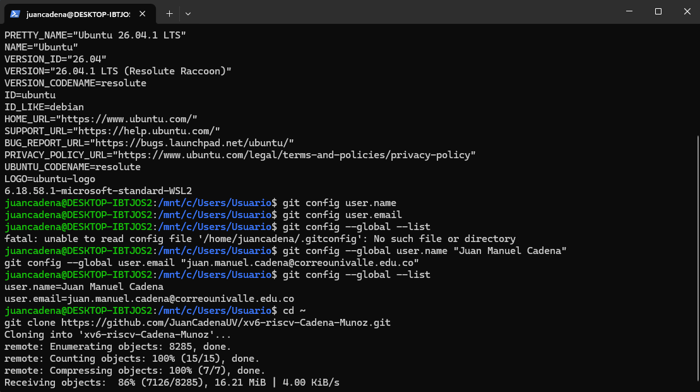
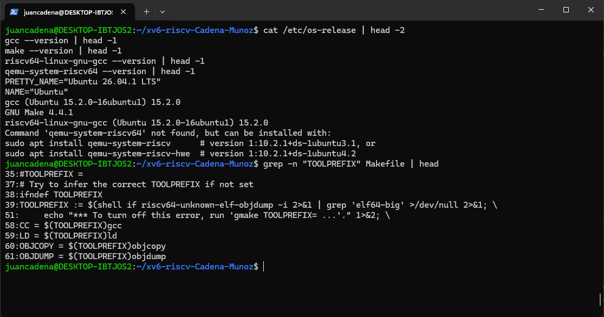
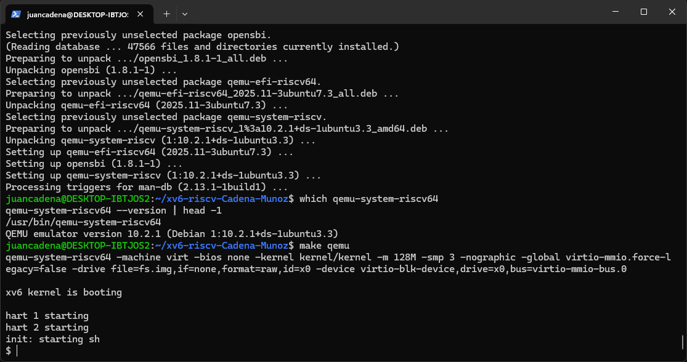
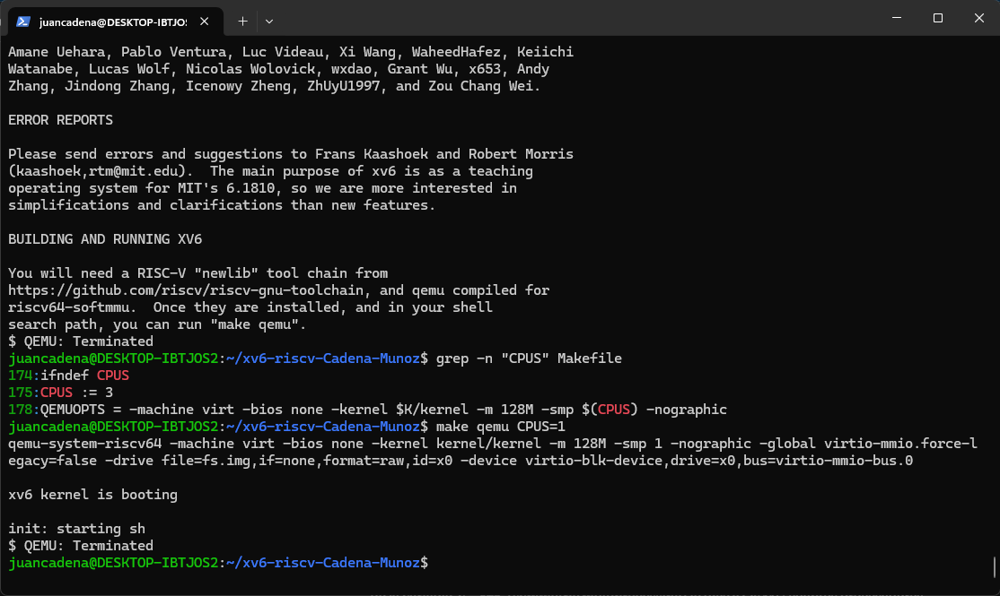
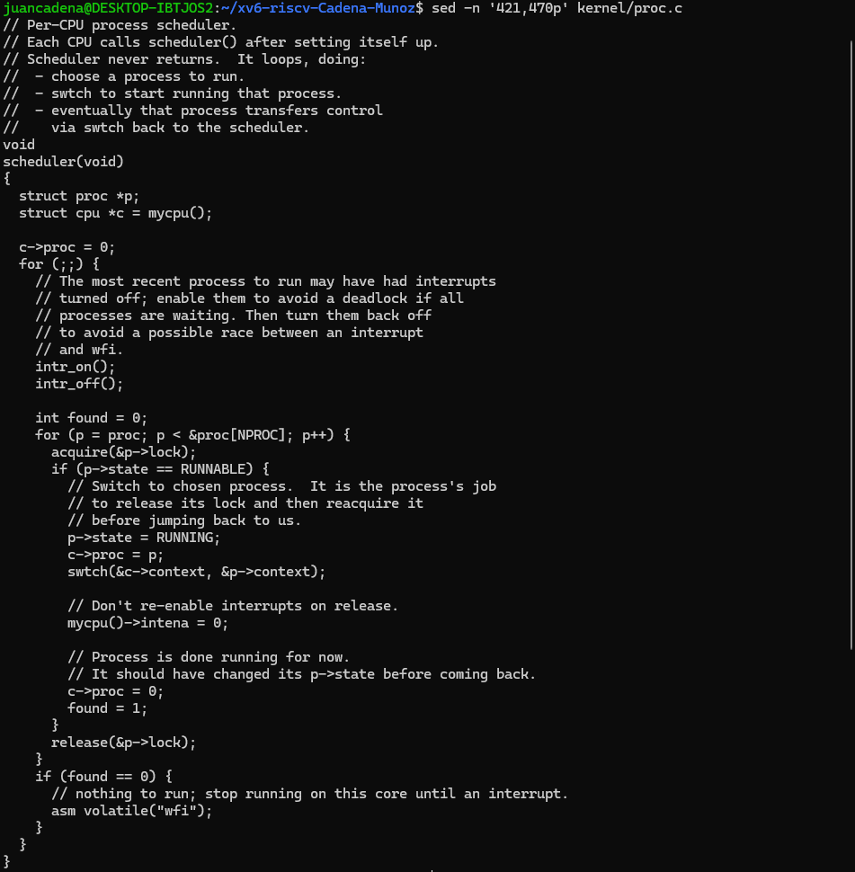
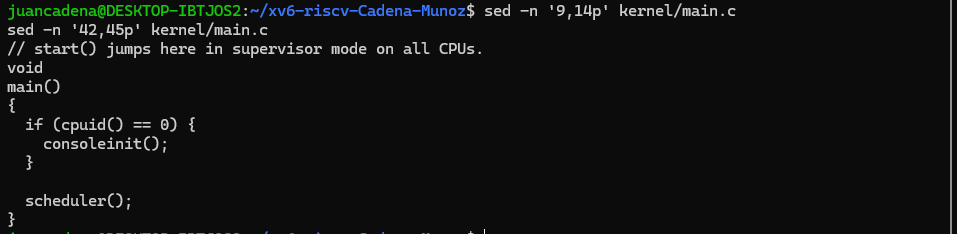
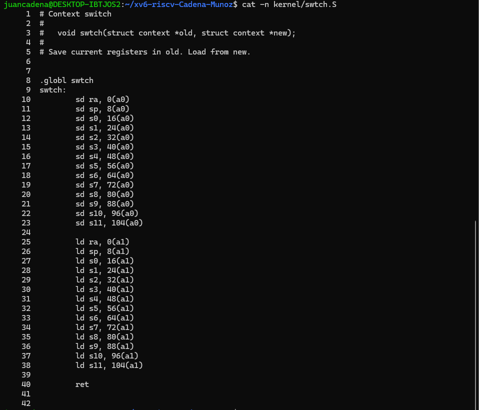
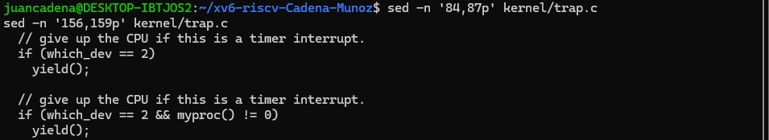
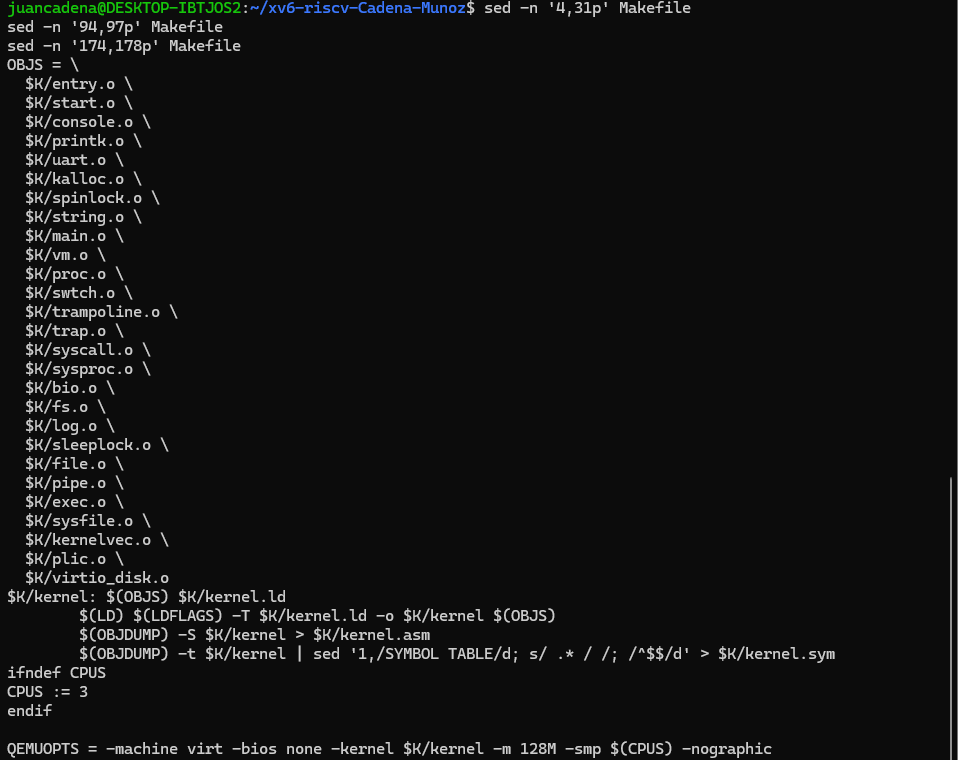

# Exploración de la planificación de procesos en XV6
## 1. Preparación del repositorio.
### 1.
i.La versión de Linux del sistema operativo donde clonaron el código fuente:

WSL: Ubuntu en WSL versión 2, con Ubuntu 26.04.1 LTS (Resolute Raccoon) y kernel 6.18.58.1-microsoft-standard-WSL2.

ii.El identificador del commit del código fuente desde el cual ustedes comienzan a trabajar:

Fork: https://github.com/JuanCadenaUV/xv6-riscv-Cadena-Munoz
Commit de partida: fa2ddcb7ca87a77af579380a6eafd5aff163b44f

### 2.

Los comando que se presentarán a continuación son ejecutados desde WSL/Ubuntu:

i.Identifiquen y registren la versión de las herramientas que les permitirán compilar y ejecutar elsistema operativo XV6:

Las herramientas necesarias para compílar y ejecutar de XV6, según la IA (Claude Sonnet 5.5), "XV6 para RISC-V necesita un compilador cruzado RISC-V, QEMU y utilidades de compilación."
A lo cual el comando para hacer la instalación de estas herramientas es el siguiente:

sudo apt update
sudo apt install -y build-essential git gdb-multiarch qemu-system-misc gcc-riscv64-linux-gnu binutils-riscv64-linux-gnu

- Tuve un problema con el archivo para el RISC-V por ende tuve que instalar lo siguiente a parte:

sudo apt install -y qemu-system-riscv 

Además, para comprobar las versiones la IA nos propuso los siguientes comando:

cat /etc/os-release | head -2
gcc --version | head -1
make --version | head -1
riscv64-linux-gnu-gcc --version | head -1
qemu-system-riscv64 --version | head -1

Además, para detectar el compilador cruzado:

grep -n "TOOLPREFIX" Makefile | head

## 2. Compilación y ejecutar XV6.
### 1. Compilen el código fuente del sistema operativo, ejecútenlo y utilicen algunos comandos, por ejemplo, ls y cat.

### 2. Configuren la ejecución del sistema operativo XV6 para que utilice una sola CPU virtual en qemu.

i.Consulten cómo se establece el número de CPU virtuales al ejecutar XV6.

Para entender sobre el número de CPUs virtuales que se ejecutan, la IA nos indico que al momento de iniciar observaramos "-smp 3" y los "hart 1 starting, hart 2 starting":

juancadena@DESKTOP-IBTJOS2:~/xv6-riscv-Cadena-Munoz$ make qemu
qemu-system-riscv64 -machine virt -bios none -kernel kernel/kernel -m 128M *-smp 3* -nographic -global virtio-mmio.force-legacy=false -drive file=fs.img,if=none,format=raw,id=x0 -device virtio-blk-device,drive=x0,bus=virtio-mmio-bus.0
xv6 kernel is booting

*hart 1 starting*
*hart 2 starting*
init: starting sh

ii.En su informe indiquen el comando o el ajuste de configuración que utilizaron y presentenevidencia de que el sistema operativo XV6 se está ejecutando con una sola CPU virtual.

El comando que utilizamos fue:

make qemu CPUS=1

Nos fijamos y al arrancar aparece "-smp 1" y no aparecen las lineas hart 1 starting ni hart 2 startin.
Por eso, al momento de escribir "CPUS=1" en la línea de comandos, make define esa variable antes de leer el Makefile.

## 3. Investigar el planificador original.
### 1. Mediante la lectura del código, la documentación y el diálogo con la IA, respondan en sus propias palabras:

i.¿Qué algoritmo o política de planificación utiliza XV6 por defecto? En su informe explique como sepuede evidenciar en el comportamiento del sistema operativo que ese es el algoritmo de planificación. Muestre evidencia que sustente su explicación.

XV6 usa Round Robin, pero aquí no hay prioridades porque todos los procesos son tratados igual. La función recorre todos los procesos de principio a fin, y a cada proceso que esta en listo le toca correr un momento y cuando se acaba su tiempo, le toca al siguiente, y así dan vueltas.

Ruta:
~/xv6-riscv-Cadena-Munoz/kernel/proc.c

ii.¿En qué archivo y función se implementa la operación del algoritmo de planificación donde se hace laselección del siguiente proceso a entrar a la CPU?

El archivo donde se implementa el algoritmo de planificación: kernel/proc.c, y la función es: scheduler()

Este tiene un ciclo infinito. Dentro, el for recorre proc[NPROC] y toma el primer proceso con p->state == RUNNABLE.
Si en toda la vuelta no encontró ninguno, la CPU espera con wfi hasta que llegue una interrupción.

Nuestra imagen 5 evidencia también el ciclo for donde se implementa el algoritmo. Por tanto, la imagen anterior nos basta para mostrar evidencia de ambos puntos.

Rutas:
~/xv6-riscv-Cadena-Munoz/kernel/proc.c
~/xv6-riscv-Cadena-Munoz/kernel/main.c

iii.¿Cómo se relaciona esa selección del proceso con los estados de los procesos (el proceso que está enla CPU y el proceso que va a entrar a la CPU) y con los eventos que permiten ceder o recuperar laCPU?

El proceso que entra a la CPU pasa de RUNNABLE a RUNNING. Esto lo hace scheduler(), luego "swtch" cambia a su contexto. El Proceso que sale de la CPU tiene que cambiar su propio estado, esto por 2 razones: 

- Se le acabó el tiempo: entonces usa yield() lo pasa de listo a ejecutando, y cambia el turno.
- Si tiene que esperar algo: pasa a sleep() y por consiguiente lo pasa a estado SLEEPING.

En ambos casos llaman a scheduler(), que hace swtch de vuelta al contexto del planificador. En ese momento scheduler() sigue ejecutándose.

Eventos para ceder la CPU:
- Para ceder la cpu lo hace mediante las funciones yield() y sleep(), y para volver a usar la CPU utiliza wakeup(), lo que hace es que recorre la tabla y pasa a RUNNABLE los procesos SLEEPING que esperaban en ese canal.

Rutas:
~/xv6-riscv-Cadena-Munoz/kernel/proc.c
~/xv6-riscv-Cadena-Munoz/kernel/trap.c
~/xv6-riscv-Cadena-Munoz/kernel/swtch.S

iv.¿Cómo se incorpora este código del algoritmo de planificación a la versión final del sistema operativodurante el proceso de compilación y construcción de XV6?

El planificador está en kernel/proc.c, función scheduler(). Durante la compilación, proc.c y swtch.S se convierten en proc.o y swtch.o. El Makefile los enlaza con kernel.ld para producir kernel/kernel, que QEMU carga con -kernel. Al arrancar, main() llama a scheduler()  y esta función queda ejecutándose para siempre.

Rutas:
~/xv6-riscv-Cadena-Munoz/kernel/proc.c
~/xv6-riscv-Cadena-Munoz/kernel/main.c
~/xv6-riscv-Cadena-Munoz/kernel/swtch.S
~/xv6-riscv-Cadena-Munoz/Makefile

## 4. Describir MLFQ y explorar su incorporación
Antes de consultar a la IA, escriban una descripción de MLFQ basada en lo estudiado. Expliquen las reglas
que conocen del algoritmo MLFQ e identifiquen sus dudas respecto al algoritmo. No es necesario que esta
primera descripción sea perfecta.

Del algoritmo MFLQ entendimos que organiza los procesos por colas y cada cola tiene una prioridad distinta de mayor a menor y que siempre que llega un proceso nuevo va a tener la mas alta prioridad y si ocupa todo el quantum de tiempo lo baja a una cola de menor prioridad, pero si por lo contrario no usa todo el quantum como por ejemplo los procesos de entrada y salida los mantiene en alta prioridad, ah y además también si dos procesos tienen la misma prioridad se ejecutan usando Round Robin.
Dudas:
¿De qué tamaño debe ser el quantum en cada cola?
¿Cuántas colas deben existir?

## PROMPT

Actúa como tutor socrático de una pareja de estudiantes de cuarto semestre de Ingeniería
de Sistemas. Conocemos C++ y hemos comenzado a explorar XV6 para RISC-V.
Queremos identificar y justificar qué se necesitaría para incorporar MLFQ a XV6. En esta
entrega no vamos a implementarlo.
Nuestra descripción inicial del algoritmo, escrita antes de esta conversación:
[Del algoritmo MFLQ entendimos que organiza los procesos por colas y cada cola tiene una prioridad distinta de mayor a menor y que siempre que llega un proceso nuevo va a tener la mas alta prioridad y si ocupa todo el quantum de tiempo lo baja a una cola de menor prioridad, pero si por lo contrario no usa todo el quantum como por ejemplo los procesos de entrada y salida los mantiene en alta prioridad, ah y además también si dos procesos tienen la misma prioridad se ejecutan usando Round Robin.
dudas:
¿De qué tamaño debe ser el quantum en cada cola?
¿Cuántas colas deben existir?
].
Lo que averiguamos del planificador original y de su incorporación al sistema compilado:
[i. ¿Qué algoritmo usa XV6?

XV6 usa Round Robin, pero aquí no hay prioridades todos los procesos son tratados igual. La función recorre todos los procesos de principio a fin, y a cada proceso que esta en listo le toca correr un momento y cuando se acaba su tiempo, le toca al siguiente, y así dan vueltas.

evidencia:
[for (;;) {
  ...
  for (p = proc; p < &proc[NPROC]; p++) {
    acquire(&p->lock);
    if (p->state == RUNNABLE) {
      p->state = RUNNING;
      c->proc = p;
      swtch(&c->context, &p->context);
      ...
    }
    release(&p->lock);
  }]

ii. ¿Dónde se elige el siguiente proceso?
En el Archivo: kernel/proc.c, y en la función: scheduler() 

Tiene un ciclo infinito. Dentro, un for recorre proc[NPROC] y toma el primer proceso con p->state == RUNNABLE.

Si en toda la vuelta no encontró ninguno, la CPU espera con wfi hasta que llegue una interrupción.

evidencia: 
[if (p->state == RUNNABLE) {
  p->state = RUNNING;
  c->proc = p;
  swtch(&c->context, &p->context);

if (found == 0) {
  asm volatile("wfi");
}]

iii. Estados y eventos

El proceso que entra a la CPU pasa de RUNNABLE a RUNNING. Lo hace scheduler(), y luego swtch cambia a su contexto.

El Proceso que sale de la CPU tiene que cambiar su propio estado, que puede ser porque: 

Se le acabó el tiempo: entonces usa yield() lo pasa de listo a ejecutando, y cambia el turno.
si tiene que esperar algo: pasa a sleep() y por consiguiente lo pasa a estado SLEEPING.

En ambos casos llaman a sched(), que hace swtch de vuelta al contexto del planificador. Ahí scheduler() sigue ejecutándose.

Eventos para ceder la CPU:

para ceder la cpu lo hace mediante las funciones yield() y sleep().

y para volver a usar la CPU utiiza wakeup() que lo que hace es que recorre la tabla y pasa a RUNNABLE los procesos SLEEPING que esperaban en ese canal. 

evidencia:
[yield(void)
{
  struct proc *p = myproc();
  acquire(&p->lock);
  p->state = RUNNABLE;
  sched();
  release(&p->lock);
}

if (p->chan != 0) {
  p->state = SLEEPING;
  sched();
}]

iv. ¿Cómo llega este código al sistema compilado?
El planificador está en kernel/proc.c, función scheduler(). Durante la compilación, proc.c y swtch.S se convierten en proc.o y swtch.o. El Makefile los enlaza con kernel.ld para producir kernel/kernel, que QEMU carga con -kernel. Al arrancar, main() llama a scheduler()  y esta función queda ejecutándose para siempre.

evidencia:
[
Makefile, lista de objetos:

4:OBJS = \
15:  $K/proc.o \
16:  $K/swtch.o \

Makefile, enlace del kernel:

94:$K/kernel: $(OBJS) $K/kernel.ld
95:     $(LD) $(LDFLAGS) -T $K/kernel.ld -o $K/kernel $(OBJS)

Makefile, cómo lo usa QEMU:

178:QEMUOPTS = -machine virt -bios none -kernel $K/kernel -m 128M -smp $(CPUS) -nographic

kernel/main.c, arranque:

44:  scheduler();]
].
Reglas de interacción:
1. Formula una sola pregunta principal por turno y espera nuestra respuesta. No presentes
una lista completa de cambios ni una arquitectura resuelta.
2. Empieza examinando nuestra descripción de MLFQ. Ayúdanos a detectar reglas ambiguas,
ausentes o contradictorias. No sustituyas nuestra descripción por una versión terminada
ni elijas silenciosamente una variante del algoritmo.
3. Pídenos que propongamos y justifiquemos las decisiones que faltan. Después, ayúdanos a
comprobarlas con ejemplos pequeños de procesos y decisiones de planificación que nosotros
debamos resolver.
4. Guíanos para relacionar cada regla con XV6. Antes de sugerir una modificación,
pregúntanos qué comportamiento necesitamos y qué evidencia del código respalda nuestra
propuesta.
5. No supongas que tienes acceso a nuestro repositorio. Pide los fragmentos necesarios y
distingue lo observado de lo que todavía sea una hipótesis. No inventes archivos,
funciones o comportamientos de nuestra versión.
6. No entregues código de implementación, parches, una lista cerrada de archivos por
modificar ni pseudocódigo que resuelva el planificador. Revisa nuestras propuestas y
señala problemas mediante preguntas y pistas graduales. Puedes explicar conceptos previos
con ejemplos mínimos.
7. Si nos bloqueamos, reduce la dificultad de la pregunta y ofrece una pista concreta. Si
pedimos la solución directa, conserva el modo socrático.
El objetivo es que nosotros logremos:
A. Redactar una descripción revisada y coherente de la variante de MLFQ considerada.
B. Explicar qué cambios necesitaría XV6 para soportarla, indicando para cada uno su
propósito, su relación con las reglas y la evidencia del código que lo justifica.
C. Proponer escenarios para comprobar una futura implementación del algoritmo MLFQ en el
sistema operativo XV6. Pídenos que expliquemos qué procesos participarían, qué harían,
qué regla comprobaríamos y qué comportamiento esperaríamos observar. No nos entregues los
escenarios resueltos. En esta tarea solo los describiremos; no vamos a programarlos ni
ejecutarlos.
Mantén el análisis dentro del alcance de una propuesta: no necesitamos implementar MLFQ

ni construir un selector de planificadores. Ayúdanos a registrar las cuestiones que
queden pendientes de investigación.
Al finalizar, pídenos que redactemos nuestras conclusiones. Comprueba su consistencia
mediante una última pregunta aplicada a un caso concreto, sin escribir por nosotros el
reporte.
Comienza con una pregunta que permita comprobar cómo entendemos una regla de nuestra
descripción inicial de MLFQ.

1 pregunta de la IA
¡Buen punto de partida! Su descripción ya tiene varias ideas clave. Empecemos por una de ellas, porque de ahí depende buena parte del resto.

Ustedes escribieron que, si un proceso no usa todo su quantum (como los de entrada y salida), “lo mantiene en alta prioridad”. Pensemos en un caso concreto:

Un proceso A está en la cola de mayor prioridad y tiene un quantum de 10 ms. Corre durante 8 ms, hace una lectura de disco y se bloquea. Cuando el disco responde, el proceso vuelve a estar listo.

¿En qué cola debería quedar A al volver, y por qué? Además, ¿qué pasaría con su “cuenta” del quantum: empieza de cero otra vez o conserva lo que ya gastó (8 de 10 ms)? Justifiquen su respuesta explicando qué comportamiento del sistema querrían lograr con esa decisión.

No hay que mirar el código todavía. Quiero ver cómo interpretan la regla tal como la escribieron.

1 Respuesta 
creemos que al volver del disco, el proceso A se queda en la cola de mayor prioridad, pero conserva los 8 ms que ya gastó, solo le quedarian 2 ms ,porque todavía no ha cumplido su límite de 10 ms. Si la cuenta volviera a cero en cada pausa, un programa pesado podría  hacer varias pausas y mantener la máxima prioridad para siempre, utilizando siempre la CPU.

2 PREGUNTA DE IA
Su justificación es buena: identificaron un abuso real. Un proceso que corre casi todo su quantum y se bloquea justo antes de agotarlo, repetidamente, se quedaría arriba sin pagar por la CPU que consume. Su regla lo evita.

Probemos ahora esa regla con otro proceso, porque creo que puede entrar en tensión con otra parte de su descripción.

El proceso B es como un editor de texto. Cada vez que el usuario pulsa una tecla, B usa 1 ms de CPU y se bloquea esperando la siguiente tecla. Esto se repite durante minutos. Su quantum en la cola de mayor prioridad es de 10 ms, y B gasta 1 ms en cada ráfaga.

Con la regla que acaban de proponer (la cuenta se conserva entre bloqueos), ¿qué le ocurre a B después de unas cuantas pulsaciones? ¿Coincide eso con lo que ustedes querían para los procesos de entrada y salida cuando escribieron su descripción inicial?

Si encuentran una tensión, no la resuelvan todavía en abstracto. Cuéntennos qué parte de su regla la causa.

2 RESPUESTA:
Creemos que después de 10 pulsaciones de tecla, el proceso B cumple su quantum y baja de cola. y si se siguen haciendo mas pulsaciones , el proceso terminará hundido en la cola de menor prioridad de todo el sistema.
y ahi ya no coincide .Si B cae a la cola más baja, cada vez que presiones tiene que esperar a que terminen los procesos pesados.

3 PREGUNTA IA
Exacto: razonaron bien el caso. Con esa regla, B acumula 1 ms por pulsación, a la décima pulsación completa el quantum y termina castigado, justo lo contrario de lo que querían para un proceso interactivo. Y además lo conectaron con una consecuencia real: la latencia que percibe el usuario.

Ahora tienen dos reglas que chocan, y ambas nacieron de intenciones razonables:

Regla 1 (la que sirve para B): quien se bloquea antes de agotar el quantum no debe ser castigado.
Regla 2 (la que propusieron para A): la cuenta se conserva entre bloqueos para que nadie abuse.

Vamos a la causa. Ustedes dijeron que “la cuenta se conserva”. ¿Qué es exactamente lo que se está midiendo y acumulando con esa regla? ¿Es lo mismo “el tiempo que A gastó en total” que “el tiempo que A gastó de forma continua antes de bloquearse”? Fíjense en cómo se comportan A (8 ms seguidos) y B (1 ms por vez) bajo cada una de esas dos lecturas, y cuéntennos qué diferencia ven entre ellos que su regla actual no logra distinguir.

Todavía no propongan una solución completa. Primero díganos qué distingue a A de B.

3 RESPUESTA:
No es lo mismo porque la regla actual mide el tiempo total acumulado osea suma cada ms usado sin importar las pausas), en lugar del tiempo continuo es decir cuánto usa la CPU de una sola vez antes de bloquearse. Si medimos tiempo continuo (se reinicia al bloquearse): Ni A (8 ms) ni B (1 ms) bajan de cola, porque nunca llegan a 10 ms seguidos. El problema es que A puede abusar y consumir mas CPU.
Si medimos tiempo acumulado (se guarda la cuenta): Ambos bajan de cola al sumar 10 ms. El problema es que B termina castigado tras pulsar 10 teclas.

REFLEXION INDIVIDUAL:
Durante el desarrollo de este taller aprendí sobre el funcionamiento del algoritmo MLFQ mediante las reglas que tiene, como planifica sus prioridades como hace la gestión de los procesos en las colas, también aprendí y aporte en la exploración y funcionamiento de los procesos en XV6 que son mediante ROUND-ROBIN aquí no hay prioridades y gestiona usando las funciones de yield(),sleep(), wakeup(), y también en el dialogo socratico con la IA me dejo una inquietud y me hizo confrantar algunas reglas. 
